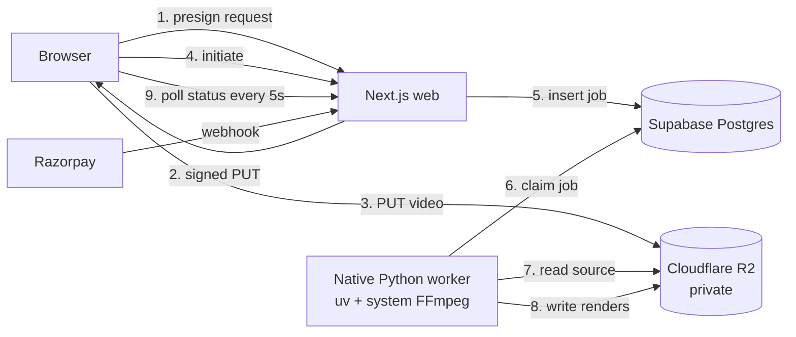

# ClipMax Architecture

Status: Phases 1–7 are implemented in code, including rate limits, monthly free-plan renewal, and
the deployment runbook. Hosted integration (Supabase, R2, Razorpay), a committed RLS CI suite,
observability, and the actual deployment are still pending. Statements below describe the behaviour
enforced by the current code unless they are explicitly marked as future work.

## 1. Goals

- Turn long-form horizontal video into vertical 9:16 clips with burned-in, word-level captions.
- Never proxy video bytes through the application server.
- Keep the browser responsive while heavy work runs in an isolated worker.
- Make credits and payments auditable, atomic, and impossible to forge from the client.
- Multi-tenant from day one: every row is owned by a user, enforced by RLS.
- Run the whole system as native processes: Node for the web, Python for the worker, with hosted
  Supabase and R2 for state.

Non-goals for v1: teams/organisations, YouTube ingestion, live streaming, mobile apps.

## 2. Topology

| Component         | Runtime                         | Responsibility                                               |
| ----------------- | ------------------------------- | ------------------------------------------------------------ |
| `apps/web`        | Next.js 16, Node 24             | UI, auth session, presigning, credit checks, webhooks        |
| `packages/shared` | TypeScript                      | DTOs, zod schemas, status unions, credit math                |
| `apps/worker`     | Python 3.12 + system FFmpeg, uv | download, transcribe, analyse, crop, caption, render, upload |
| Supabase          | hosted Postgres 17 + GoTrue     | identity, data, RLS, job queue                               |
| Cloudflare R2     | hosted, S3-compatible           | private source and render objects                            |
| Razorpay          | subscriptions                   | payment source of truth via signed webhooks                  |

There is no queue service and no dispatcher: the `processing_jobs` table is the queue. This removes
an entire moving part while preserving lease-based claiming and retry semantics.

## 3. Upload path

1. `POST /api/uploads/presign` validates the session, MIME type, extension, and declared size.
2. The API creates a `projects` row in `uploading` with a deterministic key:
   `sources/{userId}/{projectId}/source.{ext}`.
3. It returns a presigned `PUT` valid for **15 minutes**, with the exact `Content-Type` the client
   must send. The signature is bound to that header.
4. The browser uploads with `XMLHttpRequest` to get real progress. Bytes go browser → R2 directly.
5. `POST /api/projects/:id/initiate` performs a `HeadObject`, verifies existence and size, then calls
   `begin_upload_processing()`. One transaction reserves credits, records the verified size, flips
   the project to `ready`, and inserts the first `processing_jobs` row. There is no compensation
   chain to drift out of sync, and a repeated call cannot charge twice.

Why not `fetch`: `fetch` cannot report upload progress. Why not multipart in v1: single PUT covers
the 500 MB cap; multipart is a later optimisation for larger files.

## 4. Processing path

The worker is a **long-lived native Python service** started from a `uv` virtual environment. It is
not a serverless function.

1. The API inserts a `processing_jobs` row.
2. The worker claims work with `claim_next_job()` — `FOR UPDATE SKIP LOCKED`, lease timestamp,
   attempt counter — and processes until the queue is empty or the time budget is spent.
3. Every step writes progress to the job row through `update_job_progress()`, which verifies the
   worker id that holds the lease. A heartbeat thread renews the lease during long transcodes. A
   worker that loses the lease stops writing; the new owner continues from the database state.
   While a project is active, the studio polls the server-rendered page every 5 seconds. Supabase
   Realtime can replace polling without changing the job rows or the pipeline.
4. The worker exposes `/healthz` for liveness and reports whether FFmpeg, ffprobe, and the libass
   `ass` filter are ready. Production work is driven by the claim loop.

Concurrency comes from running more worker processes (or VMs). The database claim guarantees one
worker per job, so there is no second implementation of the pipeline.

The worker calls `ffmpeg` from `PATH`. The runtime verifies the binary, ffprobe, and the `ass` filter,
reports `media_ready` / `media_error` on `/healthz`, and does not claim jobs while they are missing.
There are no bundled binaries; the host provides FFmpeg.

Pipeline steps:

| Step             | Output                                                 |
| ---------------- | ------------------------------------------------------ |
| download + probe | source in a temp dir, duration/codec validation, thumb |
| audio            | 16 kHz mono PCM WAV, chunked at silence when long      |
| transcribe       | word-level timestamps → `transcripts`                  |
| highlights       | 3–5 scored moments, hook text, word-snapped boundaries |
| crop plan        | centre crop for 9:16 (face tracking is not in v1)      |
| subtitles        | `.ass` with word-level highlight and hook banner       |
| render           | 1080×1920 H.264/AAC MP4 + thumbnail                    |
| publish          | upload to R2, update `clips`, complete the job         |

Failure semantics: retry with exponential backoff up to `max_attempts`; permanent failure marks the
project `failed`, marks unfinished clips `failed`, refunds reserved credits, and stores a sanitized
error message. Job completion and failure RPCs require the owning worker id, so a reclaimed lease
cannot overwrite the new owner's state. A render job whose requested clips are all already rendered
completes successfully instead of failing and refunding.

## 5. Billing path

- Razorpay is the source of truth. The client callback is never trusted.
- `POST /api/webhooks/razorpay` reads the **raw** body with a 256 KB cap, verifies
  `X-Razorpay-Signature` with HMAC-SHA256 and a constant-time compare, then claims the event in
  `webhook_events` before any side effect. A duplicate delivery sees the claim and cannot
  double-grant; a failed handler releases the event with a short backoff so Razorpay's retry can
  succeed.
- Ownership is resolved only from the `provider_subscription_id` stored before Checkout opens.
  Notes are not trusted for routing. An event for an unknown subscription is recorded and
  acknowledged rather than retried forever.
- Subscription status changes go through `apply_subscription_event()`, which rejects out-of-order
  events by timestamp, keeps terminal states terminal, and preserves a locally scheduled
  cancellation across a later `subscription.updated` event.
- Grants run inside a `SECURITY DEFINER` function with an idempotency key, so a duplicated webhook
  cannot duplicate credits.
- Signature failures return 400 and are logged; they never touch the ledger.
- Checkout creation is serialized by `begin_checkout()`: two tabs cannot create two remote
  subscriptions, a fresh attempt inside the cooldown reuses the attached one, and a superseded
  attempt's remote subscription is cancelled.
- Free accounts receive 30 credits once per UTC month from `renew_free_plan_credits()`, called by
  the protected `/api/cron/renew-free-credits` route. The ledger key is `monthly:<userId>:<YYYY-MM>`,
  so a retried cron run grants nothing twice. Accounts created in the current month are skipped so
  the signup grant is not doubled.

## 6. Credits

Locked model: **1 credit = 1 minute of source video**, rounded up, minimum 1. A 15-minute source
costs 15 credits. Free = 30 credits/month, Starter = 150 credits/month.

- Balance lives in `credit_wallets` (cached) and is reconciled against the append-only
  `credit_ledger`.
- Only database functions mutate credits; `authenticated` has no `INSERT` grant on the ledger.
- Reservations are debited before a render. After the worker probes the real duration it calls
  `settle_project_credits()`, which refunds the unused hold; a permanent failure refunds the rest.
  Each retry uses a fresh reservation key, so a second refund is not swallowed by the first one's
  ledger entry.
- Plan limits are enforced server-side in the API and in SQL, never in the UI.
- The monthly free grant is additive, like the Starter webhook grant: unused credits stay in the
  wallet until spent.

## 7. Storage and URLs

| Object    | Key                                              | Access                                  |
| --------- | ------------------------------------------------ | --------------------------------------- |
| source    | `sources/{userId}/{projectId}/source.{ext}`      | presigned PUT 15 min, signed GET 60 min |
| render    | `renders/{userId}/{projectId}/{clipId}/v{n}.mp4` | signed GET 60 min                       |
| thumbnail | `thumbs/{userId}/{projectId}/{clipId}/v{n}.jpg`  | signed GET 60 min                       |

The bucket is private. No public bucket, no permanent URL in the database: `storage_path` stores
keys, and URLs are minted per request. `render_version` lets a re-render coexist with the previous
file until cleanup.

## 8. Tenancy and RLS

- `auth.users` → `public.profiles` via a trigger on signup.
- Every tenant table carries `user_id` and has RLS enabled.
- Policies compare `auth.uid()` to `user_id`; the planner can cache this per statement.
- `processing_jobs`, `credit_ledger`, and `webhook_events` are read-only to clients. The worker and
  webhook use the service role, which bypasses RLS **by design** and is never shipped to the client.
- Cross-tenant reads must return zero rows. `pnpm db:verify` exercises this against PostgreSQL in
  CI (PGlite, stubbed Supabase auth), together with the credit and rate-limit functions. A pgTAP
  suite against the hosted project is still missing.

## 9. Security posture

- Only `NEXT_PUBLIC_*` variables reach the browser. Secrets are validated at boot.
- Session handling uses `@supabase/ssr` cookies; `src/proxy.ts` refreshes tokens on navigation.
- Signed URLs are capability tokens: short TTL, per-object, never logged.
- Webhook verification happens before JSON parsing side effects.
- Every mutating route re-checks ownership in SQL, not just in the UI.
- Authenticated upload, project, and billing routes consume a fixed-window limit through
  `consume_rate_limit()` (Postgres, service-role only). A limiter outage is logged and fails open so
  a missed hardening migration cannot block uploads or payments; the deployment runbook applies
  migrations before promoting the app.
- The worker runs under a dedicated unprivileged OS account. Its environment comes from a protected
  systemd `EnvironmentFile`, never from source control or a committed image layer.
- R2 CORS is restricted to the production origin and `http://localhost:3000`.

## 10. Deployment **(Phase 7)**

- **Web:** Vercel or a native Node host, started with `pnpm start`, environment from the platform
  secret store.
- **Worker:** Linux VM (or a small dedicated host) running the native Python service under systemd;
  `uv` manages the virtual environment, FFmpeg comes from the OS or a pinned static build. Deployment
  is source plus package manager, with no image build step.
- **Database:** hosted Supabase. Migrations are applied from CI with the Supabase CLI against the
  linked project; backups/PITR enabled before launch. Local development uses the same hosted
  project, never a local stack.
- **R2:** CORS limited to the production origin and localhost, lifecycle rules for orphaned sources.
- **Cron:** `/api/cron/renew-free-credits` on `0 2 1 * *`, authenticated with `CRON_SECRET`. Configure
  it in the web host's scheduler (Vercel Cron or a system cron entry).
- **Runbook:** the exact commands, checks, smoke pass, and rollback table are in
  [`docs/runbook.md`](runbook.md).

## 11. Phase map

| Phase | Adds                                                       | State                             |
| ----- | ---------------------------------------------------------- | --------------------------------- |
| 1     | monorepo, shared contracts, landing shell, worker skeleton | Complete                          |
| 2     | schema, RLS, credit functions, job queue                   | Code complete; apply to hosted DB |
| 3     | presign/initiate/download routes, upload hook              | Code complete; needs R2 keys      |
| 4     | worker pipeline and rendering                              | Code complete; needs provider key |
| 5     | dashboard, upload flow, results, review                    | Code complete                     |
| 6     | Razorpay checkout + webhook + credit grants                | Code complete; needs test keys    |
| 7     | rate limits, free renewal, runbook, deployment             | In progress; deploy needs keys    |
